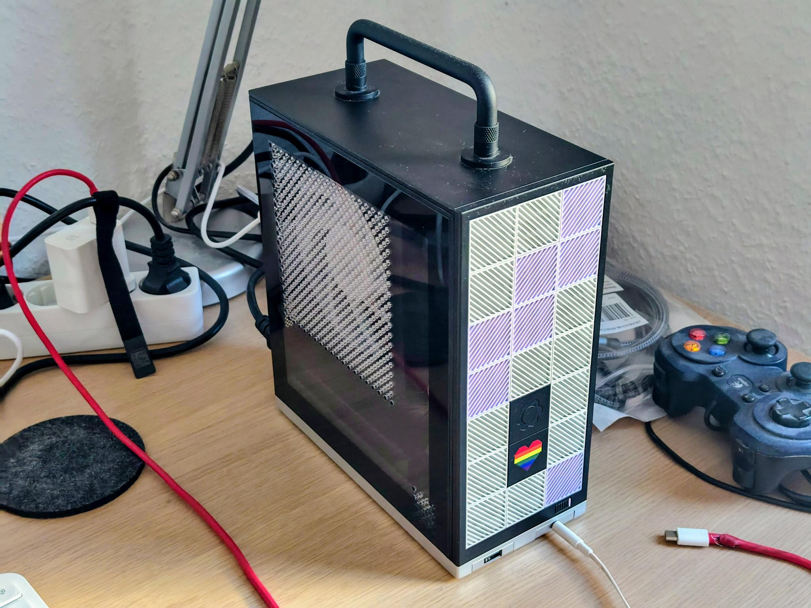
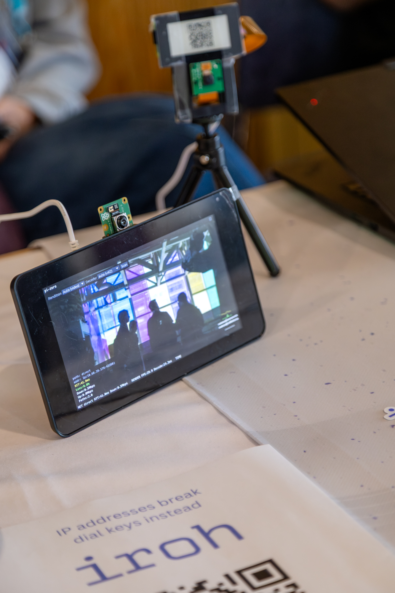
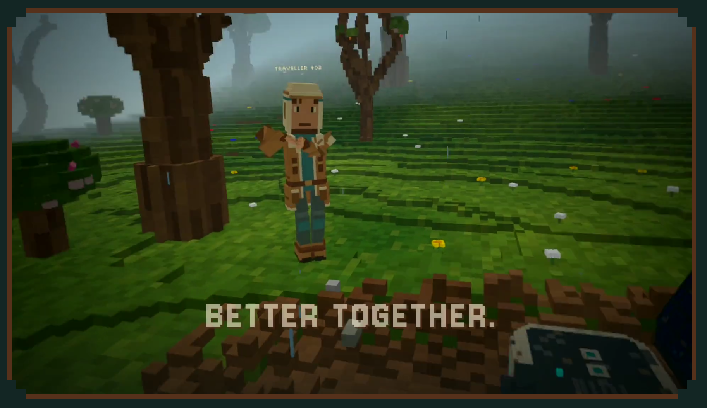

# We have QUIC at home

How iroh connects devices peer-to-peer

Philipp Pohl-Krüger · @matheus23.com · [n0.computer](https://n0.computer)

<!--
Show of hands: Who's written a program that connects two devices at home?
Maybe a multiplayer game?
Maybe sth to remote-control?
How did that go?
-->

---

# Computers talking to each other

<v-clicks>

```rust
use tokio::net::TcpStream;

let connection = TcpStream::connect("<IP address>:<port>").await?;
let (mut recv, mut send) = connection.into_split();
```

- yay streaming!
- yay bidirectional!
- yay reliable!
- yay congestion controlled!

</v-clicks>

<!--
- So you want to talk to another computer. We do this all the time!
- You do the most common thing: `TcpStream::connect` with an IP address
	- you can now send arbitrary data back and forth
	- streaming!
	- bidirectionally!
	- it's reliable!
	- it has congestion control!
- You're happy
-->

---

# Computers talking to each other?

<SceneMigration />

<!--
- Now, turns out you used your phone to connect to another computer
- The connection was live, but you went outside and your phone switched from Wifi to Cellular.
- Oops! The connection is broken. Why?
- A computer can have many TCP connections alive simultaneously at any point in time. And if an IP packet makes it to your server, which connection should it be associated with? Well - you'd use the address and port number to figure it out!
	- We say "TCP connections are identified by four-tuple: (one end IP address, one end port, other end IP address, other end port)"
- So what do we do?
-->

---

# Computers talking to each other?

<v-clicks>

Roaming mitigations:

- Redialing:
  - Costs more handshakes
  - Most importantly: Which data was lost?

<v-click>

- Drop down to UDP:
  - loose reliability, deduplication, congestion control, etc.

</v-click>

</v-clicks>

<!--
- We could re-dial another TCP connection on the phone, once we realize we moved
	- need to figure out that we moved (this can be trickier than you'd think!)
	- needs another TCP handshake
	- and depending on how you do it, often also another handshake for encryption (ouch)
	- Might be a hiccup for 1-3 seconds or more.
	- Hard to know which data went lost and which data didn't!
		- This is probably the trickiest thing
- We could drop down to a "connectionless" protocol: UDP
	- But now you loose a lot of nice things TCP gives you:
		- reliability (retransmit lost data?)
		- deduplication (realize some data was accidentally duplicated)
		- congestion control (proactively *avoid* packet loss, make efficient use of resources)
			- notoriously complex! very active research area, lots of exciting things happening all the time
-->

---

# Better: adopt QUIC!

<v-clicks>

- Started out as "SPDY" at Google
- Standardized as "QUIC" by the IETF in RFC 9000
- Built on UDP

```rust
use noq::Endpoint;

let endpoint = Endpoint::client("[::]:0".parse()?)?;
let connection = endpoint.connect(addr, "example.com").await?;
let (mut send, mut recv) = connection.open_bi().await?; // as many as you want
```

- retransmission & congestion control
- many streams (no head of line blocking!)
- encryption
- connection migration(!)

</v-clicks>

<!--
- Don't reinvent the wheel - once upon a time Google already did the work of building upon UDP, back then they called it "SPDY" ("speedy")
	- They took it to the IETF to get it standardized and that turned into QUIC with a lot of work from others who also adopted it
- You call `endpoint.connect` with an IP addr and port
- You get a `Connection`, and on that can call `Connection::open_bi` to get as many tcp-like "bidirectional streams" as you want. It's great!
- QUIC can prefix all your datagrams with a "connection ID" so it can survive changes to your four-tuple!
	- This is called "connection migration" and it's really really useful!
- Handles congestion control, retransmission, and even encryption for you!
-->

---

# Can we talk to *any* computer?

<v-clicks>

"In the cloud" really just means: *at a public IP address with an open port*

What about my own server at home?



</div>

</v-clicks>

<!--
- Until now we've run our server "in the cloud"
	- more like, "with a public IP address" and "with an open port configured in our firewall"
- But what if I want to connect to my server at home?
	- In theory over the internet, *all of the computers connected to it* can talk to each other!
		- That's actually mind-blowing!
	- But we only ever think of "talking to the cloud". Our personal devices are always assumed to be clients, and we assume that they can only talk via a middleman "a website"/"a server".
		- That's a bummer :(
- Let's say my phone is in my local network, the connection might even work!
- But when I go touch grass again, my phone switches to cellular and the connection breaks. QUIC or not.
	- That's due to NAT and firewalls.
-->

---

# Can we talk to *any* computer: Addressing

<v-clicks>

```rust
let endpoint = Endpoint::client("[::]:0".parse()?)?;
endpoint.local_addr()?; // uuh [::]:12345
```

```bash
$ ip addr show
    inet 192.168.1.101/24 ...
```

- that address is not globally unique
- not actually the address that servers use to talk to my machine on the internet

</v-clicks>

<!--
- When we ran our server at home, which address did we use?
- Say we called `Endpoint::client([::]:0)`, which means "listen on any local interface, allow network traffic" (as opposed to e.g. `Endpoint::client(127.0.0.1)`.)
	- Then asking `Endpoint::local_addr` gives you `[::]:12345`, which is not helpful. But hey at least we got the actual port!
	- `ip addr show` gives you the IP addresses of your interfaces... maybe look at the Wifi one? It shows `192.168.1.101`. This is what connecting to worked for at home.
		- As many of you probably know, the `192.168.*.*` prefix is common net prefix for home networks.
	- But it's not the global address!
-->

---

# NATs

<SceneNat />

<!--
- your device's address is not "globally unique" so to say
	- (we're short on IPv4 addrs)
	- Also allows for separating "global" from "local" access
- our server at home has a local address from its router like 192.168.1.101
- so what happens when it actually talks to something in the cloud?
- device dials 1.1.1.1
- IP packet with src: 192.168.1.101:12345 and dst: 1.1.1.1:53
- router has public IP 203.0.113.20
- IP packet gets translated with src: 203.0.113.20:6543
	- router remembers 203.0.113.20.6543 <-> 192.168.1.101:12345
- once 1.1.1.1 answers, the IP packet gets translated "back" on the router
-->

---

# NATs

<SceneNatMapping />

<!--
- Question: if I later send to 8.8.8.8 from the same port, will that re-use the same port?
	- IT DEPENDS :) but mostly yes.
- There are two types of mapping:
	- EIM: no matter the destination IP address, once a mapping exists for an internal address-and-port, it will be used for incoming traffic.
	- ADM & APDM: mappings for local addresses exist for each outbound address
	- (Also called "Full-Cone or symmetric NAT" respectively)
- What would A(P)DM mean?
  - Multiple possible "public" socket addresses for our socket!
  - Harder for the outside to "guess" the port needed to talk to our socket
-->

---

# Firewalls

<SceneFirewall />

<!--
- Let's say we've sent a packet to 1.1.1.1, but then it's 8.8.8.8 that answers to us for some reason. The router is using EIM. Does the router allow the packet through?
	- Answer: IT DEPENDS! But mostly no.
- Filtering could be off
- or Address-Dependent-Filtering (ADF): 8.8.8.8 can't answer, but another port on 1.1.1.1 can
- or Address-and-Port-Dependent-Filtering (APDF): neither 8.8.8.8 nor another port on 1.1.1.1 can answer. Only 1.1.1.1:53 can.
- knowing all of this, how can we make "the dream" work?
-->

---

# Talking to another computer with iroh

<v-clicks>

```rust
use iroh::Endpoint;

let endpoint = Endpoint::bind(iroh::presets::N0).await?;
let connection = endpoint.connect(...).await?;
let (mut send, mut recv) = connection.open_bi().await?;
```

- standard QUIC API
- Except: How do we address another device?

</v-clicks>

<!--
- in light of all of this, how does iroh make it possible to talk to another computer?
- First, let's be modern and use QUIC
- So it's `endpoint.connect`
-->

---

# Identifying another device

<v-clicks depth="2">

- `endpoint.connect("192.168.1.101:12345")`
  - 😕 only works locally, can change
  - 😕 unclear how to do authentication
- `endpoint.connect("device.name.example.com")`
  - 😕 requires central coordination for handing out names
- iroh: `endpoint.connect(<Ed25519 public key>)`
  - collisions impossibly unlikely
  - can be generated without internet access
  - public key can be used for authenticated encryption

</v-clicks>

<!--
- first: how do we identify the other side?
	- we established that a single IP address might not be enough or even change!
	- if we use a name e.g. domain name, we need a central registry to ensure we don't accidentally re-use the same name when one side is offline
	- we want to work, even if WAN is unavailable, but LAN allows connecting two nodes.
	- so we use a public key to identify another device!
- `endpoint.connect(<public key>)`
	- we call these "Endpoint ID"
	- are just Ed25519 public keys, usually hex-encoded
	- works in a network split
	- gives us authenticated encryption, too
-->

---

# Identifying another device

- iroh: `endpoint.connect(<Ed25519 public key>)`
  - collisions impossibly unlikely
  - can be generated without internet access
  - public key can be used for authenticated encryption
  - 😕 not memorable, solutions are application-specific:
    <ul>
      <li v-click>scan via QR code</li>
      <li v-click>trust-on-first-use (TOFU) when exchanged locally: mDNS/bluetooth/NFC</li>
      <li v-click>central registry for your app, cache locally for offline use</li>
      <li v-click>could use AT protocol!</li>
    </ul>

<!--
- figuring out the name to talk to another device is difficult. you can't expect a human to memorize it. It's very application-dependent. Some cases:
	- scan via QR code
	- TOFU via local-only (e.g. bluetooth/mDNS/nfc)
	- central registry for your app (database with user account to devices EndpointId mappings)
		- could also use something like the AT protocol(!)
-->

---

# Sending “to a public key”

<v-clicks depth=3>

- Resolve `EndpointId` to address candidates
  - candidates are records usually *signed by the `EndpointId`*
  - `AddressLookup`: pluggable trait
    - central server publishing address records (most popular)
    - mDNS gossiping addresses in LAN
    - gossip protocol among currently connected peers
    - anything: bluetooth, LoRa, unix domain sockets, ...
- Then send the first datagram to all candidates at once

</v-clicks>

<!--
- still need to actually send UDP packets. That means IP addresses
- so iroh resolves the EndpointId to candidate addresses through pluggable AddressLookup services
	- most popular: a central server that publishes signed addressing records for endpoints
	- in the LAN: mDNS, endpoints gossiping their own addresses
	- or gossip among peers we're already connected to
	- it's just a trait: bluetooth, LoRa, whatever your app has
- and since we don't know which candidate will answer, the Initial datagram is duplicated to all candidates
- whichever one answers first wins and becomes the first remote address
-->

---

# Still need to deal with firewalls

<SceneFanout />

<!--
- now the phone dials the laptop's EndpointId
- address lookup gave us candidates: the laptop's LAN address, and its router's public address
- iroh sends the first datagram to both at once
- the cellular tower has no route to 192.168.*.* — that's private space
- and the laptop's router drops the unsolicited incoming packet — firewall closed
- so: candidate addresses alone get us nowhere. We need help.
-->

---

# Relays!

<SceneRelay />

<!--
- we use relays to bootstrap these connections
- relay connections are just HTTP 1.1 with websockets
	- probably most reliable option for "any kind of connectivity" in the internet and various corporate environments, hotels, etc.
- we send UDP datagrams via websocket messages and they're relayed to the recipient by the relay
- relays are also how endpoints figure out their own IP address
- but we try to switch from relayed to direct traffic as soon as possible
- to get through firewalls, we use "hole-punching"
-->

---

# Hole-punching

<SceneHolePunch />

<!--
- to ensure both sides know the addresses that should be tried for hole-punching, we share them via the live connection
- when a connection is established, we immediately send ADD_ADDRESS frames from the server side to the client to inform it about "other addresses" that the server could be reachable under
	- these frames are QUIC-level control frames that live in a "separate namespace" to application traffic so to say. They're prioritized over all application traffic
- the client then initiates hole-punching
	- sends REACH_OUT frames with its own addresses
	- simultaneously sends PATH_CHALLENGE frames to the server addresses
	- this opens firewall ports due to outbound traffic in the cellular tower (so a server can answer)
- the server recieves the REACH_OUTs via the relay, then ... etc.
-->

---

# Paths

<ScenePaths />

<!--
- We use QUIC multipath, which means we don't "migrate" between relay and direct, we *keep both alive at the same time*
- This means each path has its own congestion controller, loss stats and RTT estimator.
	- instead of this state having to be re-derived every time we need these paths again
- it means if one path breaks, we can quickly switch to antoher path that's still "warm"
- e.g. if our relay path breaks, we can detect so early, and dial another relay instead and establish a path in the background while the direct path keeps working normally
- or if the laptop router's NAT is rebound, we can quickly fall back to the relay, while we coordinate hole-punching another direct path again
-->

---

# Paths: more direct

<SceneLan />

<!--
- last variant on the "internet": no WAN at all
- laptop and phone under the same router, internet is down — or just not needed
- endpoints announce themselves over mDNS within the LAN
- -> direct connection through the router, traffic never leaves the local network
-->

---

# Paths: even more direct

<SceneWifiDirect />

<!--
- and finally: no router at all. Just the two devices.
- over bluetooth they exchange each other's Wi-Fi Direct addresses
- then a Wi-Fi Direct link is established directly between the two devices
- fun fact: this can *also* need firewall ports to be opened!
- disclaimer: experimental — not in the official crates yet, and it needs iroh changes
- but a direct bluetooth custom transport exists already!
-->

---

# Cool, what can we do with this?

- Connect (almost) all internet-connected computers in the world!
- Relays are cheap to operate
  - 95–98% of bytes between endpoints end up being sent directly
- Relays are identified by URL
  - self-host them!
  - discover relay URLs you didn't know about and just connect
- Relays are optional if you're on the same network

<!--
- so to wrap up the "how":
	- any two computers, anywhere, connect and stay connected
	- relays are cheap: just HTTP + websockets forwarding UDP datagrams
		- and 95-98% of traffic goes direct anyway
	- relay URLs are just configuration: point at ours or run your own
	- endpoints can discover each other's relay and use it to connect
	- and if both are on the same network, it works offline too
-->

---

# Demo

<!--
- Show I've set up "pigeons" on my machine
- Show `~/.ssh/config`
- Open zed on my laptop to connect remotely to my home machine
-->

---

<div class="centered-image">



</div>

<!--
- Image from RustConf this year with raspberry Pi camera feed
-->

---

# [meshllm](https://meshllm.cloud/)

---

[](https://starworn.net)

---

# Thank you

- Hope you enjoyed this journey through NATs and firewalls
- We have QUIC at home 🏠
- See you in discord! [iroh.computer/discord](https://iroh.computer/discord)
- [iroh.computer](https://iroh.computer) for docs, a blog and more
- eager to see what you build with it!

<!--
- thanks folks!
- iroh.computer/discord if you want to hang out, ask questions, or show off what you built
- iroh.computer/docs for all of this in written form
-->
